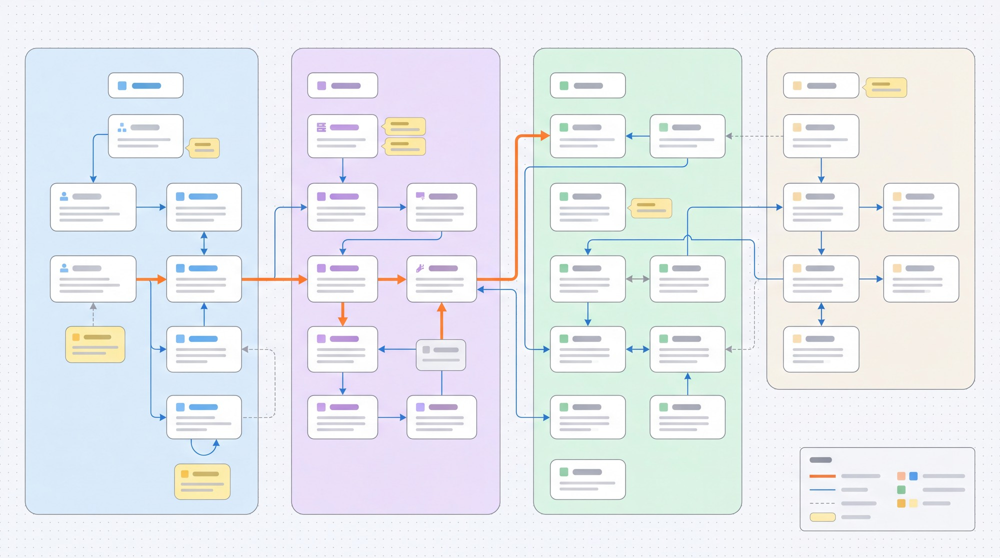

# 拓扑 · Topology Skill

一个通用、离线、可交互的节点关系拓扑图生成技能。将分组、节点、关系与备注整理为 JSON，即可生成无需安装依赖、可直接双击打开的独立 HTML 页面。

适用于系统架构图、服务依赖图、数据流向图、页面导航图、设备连接图、组织关系图及其他节点关系拓扑。



## 功能

- 横向多列分组、柔和底色、圆角节点与黄色备注
- 主链路、普通连接、辅助虚线、双向关系与自关联回环
- 正交连线、并行关系分散、标签底色与动态图例
- 无限画布、拖动平移、鼠标中心缩放、初始适配全图
- 按节点名称、标识、分组或备注搜索定位
- 节点及直接关联关系聚焦，无关内容同步淡化
- 完整高清 JPG 导出，不受当前视口和选中状态影响
- 全部 CSS、JavaScript 与数据内嵌，无外部运行时依赖

## 快速开始

需要 Node.js 18 或更高版本，仅使用 Node.js 内置模块。

```bash
node scripts/build-topology.mjs examples/basic.json topology.html
```

然后用浏览器打开生成的 `topology.html`。

覆盖已有输出文件：

```bash
node scripts/build-topology.mjs examples/basic.json topology.html --force
```

## 数据格式

```json
{
  "title": "示例拓扑",
  "groups": [
    { "id": "group-a", "name": "分组 A", "columns": 1 }
  ],
  "nodes": [
    {
      "id": "node-a",
      "name": "节点 A",
      "group": "group-a",
      "tags": ["入口"],
      "details": { "状态": "启用" }
    }
  ],
  "edges": [
    {
      "from": "node-a",
      "to": "node-b",
      "label": "主数据流",
      "type": "main",
      "bidirectional": false
    }
  ],
  "notes": [
    { "id": "N01", "target": "node-a", "text": "补充说明" }
  ]
}
```

### 连线类型

| 类型 | 样式 | 用途 |
| --- | --- | --- |
| `main` | 橙色粗实线 | 主数据流、核心链路、关键路径 |
| `normal` | 蓝色细实线 | 普通连接、跳转、流向或依赖 |
| `aux` | 灰色虚线 | 辅助、可选、定时或不改变当前状态的关系 |

`bidirectional: true` 会在连线两端显示箭头。相同起终点的并行关系会分散排布，自关联会生成显式回环。

完整输入约定和内容完整性规则见 [SKILL.md](SKILL.md)。

## 目录结构

```text
├── SKILL.md
├── assets/
│   └── topology-template.html
├── docs/
│   └── cover-image-prompt.md
├── examples/
│   └── basic.json
└── scripts/
    └── build-topology.mjs
```

## 作为助手技能使用

将本目录放入支持 `SKILL.md` 的技能目录。之后可向助手提供模块、节点、关系和备注，并要求“使用拓扑技能生成拓扑图”。助手应保留全部输入事实，生成文件并实际验证交互与导出。

## 隐私与离线能力

页面不引用 CDN、第三方脚本、在线字体或外部图片，不发起网络请求。JPG 在浏览器本地通过 SVG 与 Canvas 生成，不使用 `foreignObject` 或外部截图服务。

## 封面图

用于 GitHub 仓库封面或技能展示的 GPT 图片提示词见 [docs/cover-image-prompt.md](docs/cover-image-prompt.md)。图片只是展示素材，不影响技能的离线运行。
